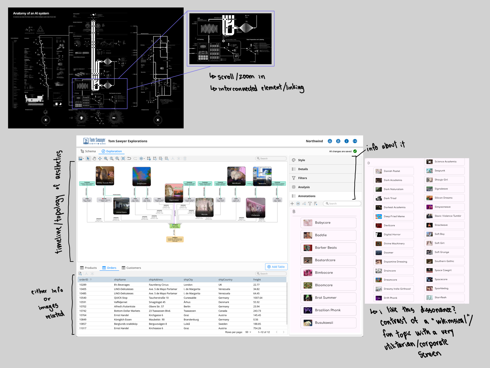
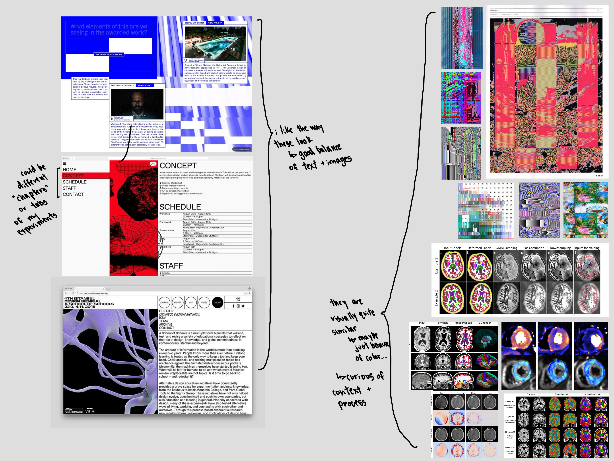

<!-- I wrote this in a google docs (for the inital brain dump of my interests and whatnot) and then used an online MD text converter lol -->

Ideation + Data Exploration– 2 possible ideas

Option 1: Internet Aesthetics: An Anatomy of Internet Culture

**What data interests me?**

I am interested in internet aesthetics as beyond a collection of visual styles, but as cultural systems that are shaped by online communities, platforms, technologies and patterns of consumption. 

The internet has produced an enormous vocab for describing aesthetics, like Vaporwave, Frutiger Aero, Webcore, Weirdcore, Dreamcore, and Seapunk. These “titles” encompass recognizable visual languages, but also carry associations with particular periods of internet history, cultural references, identities and technological imaginaries. 

I have been thinking alot about Kate Crawford and Vladan Joler's _Anatomy of an AI System_, and I want to investigate how these aesthetics emerge, circulate, evolve, and become categorized. Rather than simply mapping visual similarities, I want to trace/”plot” the different components that contribute to their formation: the imagery and media they draw from, the communities that define them, the platforms through which they spread and the language used to describe them. 

I think it would be interesting to think about/ visualize what happens when loosely defined cultural categories are translated into structured data, and whether this analysis can reveal relationships that are not immediately apparent.

**Datasets to use**

[Aesthetics Wiki Dataset — Hugging Face](https://huggingface.co/datasets/ninar12/aesthetics-wiki)

*   [https://huggingface.co/datasets/ninar12/aesthetics-wiki](https://huggingface.co/datasets/ninar12/aesthetics-wiki) 
    
*   Approximately 1,022 aesthetic entries
    
*   Contains structured textual descriptions and metadata for different aesthetics
    
*   Includes titles, alternative names, descriptions, related aesthetics, associated media, decades of origin, key motifs, brands, values, and colors.
    
*   Available in Parquet format.
    

I have previously used this dataset in a different class, so I am familiar with its structure and the information within it and I think it is a manageable starting point for investigating relationships between aesthetic categories. 

[Architecture of Internet Aesthetics — Zenodo](https://zenodo.org/records/20708760)

*   https://zenodo.org/records/20708760
    
*   Approximately 1,115 aesthetics
    
*   Includes 5,889 community-authored connections and 681 licensed images
    
*   Offers additional material for exploring relationships between aesthetics and their visual representations.
    

Additional visual references:

*   [Aesthetics Wiki](https://aesthetics.fandom.com/wiki/Category:Internet_Aesthetics) — For manually collecting images and visual references associated with different aesthetics.
    
    *   [https://aesthetics.fandom.com/wiki/Category:Internet\_Aesthetics](https://aesthetics.fandom.com/wiki/Category:Internet_Aesthetics) 
        
*   [Rhizome ArtBase](https://artbase.rhizome.org/) — For contextualizing internet aesthetics within broader digital and net art histories.
    
    *   [https://artbase.rhizome.org/](https://artbase.rhizome.org/) 
        

**What information to explore**

I am curious to examine the relationship between aesthetics through their descriptions, visual characteristics, and cultural associations. 

Features to explore/ include

*   Language: Frequently occurring words, recurring descriptions, and shared terminology.
    
*   Color: Commonly associated colors and similarities between aesthetic palettes.
    
*   Motifs: Recurring objects, imagery, symbols, and visual themes.
    
*   Time: Decades and historical periods associated with different aesthetics.
    
*   Cultural references: Associated music, fashion, media, brands, and online platforms
    
*   Relationships: Explicitly listed connections between aesthetic categories
    
*   Values and moods: Shared ideas such as nostalgia, escapism, individuality, consumerism, and technological optimism.
    

I am thinking, for example, two internet aesthetics might share similar color palettes and visual motifs while originating in different online communities or historical periods. Alternatively, they might have very different visual languages but share cultural references or associated media. It would also be interesting to trace how these relationships extend beyond the descriptions themselves, particularly into the platforms and communities where these aesthetics develop and circulate.

**What could I explore?**

*   What cultural, technological, and visual components contribute to the formation of an internet aesthetic?
    
*   What words, motifs, colors, and cultural references recur across different aesthetic categories?
    
*   Are there recognizable clusters of aesthetics associated with particular periods of internet history?
    
*   How do aesthetics from the Old Web, Tumblr, and TikTok eras overlap or differ?
    
*   Can computational analysis reveal unexpected connections between aesthetics that initially appear unrelated?
    
*   How do systems of categorization influence the way we understand and consume internet culture?
    

**Preprocessing that is necessary**

The main dataset (the hugging face one) is already structured, so I would just need to inspect it and clean it before analysis. 

*   Exploring the dataset's columns, data types, and missing values.
    
*   Identifying entries relevant to internet aesthetics.
    
*   Checking for duplicate entries and alternative names.
    
*   Cleaning descriptions and standardizing text where appropriate.
    
*   Parsing related aesthetics, motifs, colors, and values into consistent formats.
    
*   Standardizing decade labels and examining incomplete entries.
    
*   Evaluating the consistency of extracted keywords and categories.
    

I also think that is I were to incorporate additional visual information, I would also need to manually collect and organize a representative image sample, associate images with their corresponding aesthetic categories, and standardize image formats and dimensions. (hence the other internet aestehtics wiki site/catalog). I do want to note that this project would not necessarily capture the full history of an aesthetic, the communities responsible for its development, or the platforms through which it circulates. It would be treated more as a representation of internet culture rather than a definitive taxonomy. 

**What I am envisioning/ what this can become?**

I imagine an interactive visual archive or anatomy of internet aesthetics, inspired by the mapping and tracing methodology of Anatomy of an AI System. Instead of just presenting a network of aesthetic categories, I would like to investigate the relationships between their visual languages, cultural references, online communities, platforms, and commercial influences. I think for now, I am envisioning this as an interactive map/ archive that allows viewers to see how different aesthetics connect and evolve. 

\*\*\*\*\*\*\*\*\*\*\*\*

Option 2: Medical Imaging + Glitch Art– Aesthetics of Distortion

**What data interests me?**

The visual relationship between medical imaging and glitch art, particularly how both can produce images characterized by distortion, fragmentation, noise, pixelation, and visual artifacts has been of interest to me for a while. If I go this direction, this is definitely more of an abstract and exploratory project about the “image” itself. Things like how it is produced, what it looks like, and how we interpret it.

Medical imaging transforms the human body into visual and numerical information, allowing us to observe structures that cannot ordinarily be seen. Medical images are not always perfect representations. Technical limitations, patient movement, and interference during image acquisition can introduce artifacts that obscure anatomical information or complicate interpretation.Glitch art is often intentionally produces similar forms of visual disruption through image manipulation, data corruption, and software-based processes, transforming technical errors into aesthetic expressions.

I find it fascinating that similar visual phenomena can be interpreted so differently depending on their context and origin. A distorted medical scan might be considered an imaging error, while a visually similar distortion in an artwork might be considered expressive or aesthetically compelling. I want to think about this tension and experiment with how computational methods might reveal unexpected visual relationships between images produced for entirely different purposes.

**What datasets will I use?**

I am considering combining a medical imaging dataset with a collection of glitch art. 

Medical datasets
* [Brain CT Medical Imaging Colorized Dataset — Kaggle](https://www.kaggle.com/datasets/shuvokumarbasakbd/brain-ct-medical-imaging-colorized-dataset)

    * A collection of colorized brain CT scans. Examining color, contrast, and the relationship between grayscale medical imagery and artificially introduced color.

*   [Brain MRI Images — Kaggle](https://www.kaggle.com/datasets/ashfakyeafi/brain-mri-images) 

    * A collection of brain MRI images that could provide material for exploring anatomical structures, texture, contrast, and visual variation.

*   [Fundus Image Dataset for Vessel Segmentation — Kaggle](https://www.kaggle.com/datasets/nikitamanaenkov/fundus-image-dataset-for-vessel-segmentation) 
    * Retinal images and vessel segmentation masks.The branching structures, networks, and patterns found within these images.

*   [Brain Tumor MRI Dataset — Kaggle](https://www.kaggle.com/datasets/masoudnickparvar/brain-tumor-mri-dataset) 
    * A collection of brain MRI images organized by tumor categories. Exploring how medical labels and classifications relate to visual characteristics.
    
        

Glitch Art References

*   [Rhizome ArtBase](https://artbase.rhizome.org/) — An archive of born-digital artworks, experimental media, and net art.
    
    *   [https://artbase.rhizome.org/](https://artbase.rhizome.org/)
        
*   [https://glitchgallery.org/](https://glitchgallery.org/) 
    
*   Unlike the medical datasets, these archives are not standardized downloadable collections of glitch images nor are they in a clean json/csv file format. I would likely need to manually curate a smaller collection of representative works, documenting their artists, sources, and methods of distortion where available…
    

**What can I explore?**

I want to experiment with the visual characteristics shared between medical imaging artifacts and glitch art, specifically where different forms of distortion produce similar visual effects

*   Noise: Grain, interference, and random variations in image intensity.
    
*   Pixelation: Resolution, compression, and block-like structures.
    
*   Fragmentation: Broken, repeated, or incomplete visual structures.
    
*   Color and contrast: Monochromatic imagery, RGB separation, false color, and intensity variation.
    
*   Geometry: Displacement, warping, repetition, and spatial distortion.
    
*   Texture: Patterns, visual density, and variations in surface appearance.
    

This is also a bit inspired by the different exercises that we did in class with the color isolation and changing (the forest, flowers and the hedgehog images). I want to explore whether images from different collections share recognizable visual characteristics, even when their original contexts and production processes are unrelated. I do want to preserve the original dataset labels and contextual information, so that I could compare computationally identified similarities with the actual origins and meanings of the images and see if there is room to do something more poetic/ “analysis”-like. 

**Questions to possibly explore**

*   What visual characteristics do medical imaging artifacts and glitch art share?
    
*   How does the distinction between intentional and unintentional distortion affect how we interpret an image?
    
*   How do technological limitations and failures influence the way we perceive and interpret images?
    
*   What changes when images are organized according to visual resemblance rather than their original medical or artistic classifications? 
    

I have been thinking a lot about the “image” and its technical production, its visual appearance, and the meaning associated with it. 

**Preprocessing steps**

The medical and artistic collections would require different forms of preparation. Although in a way they are also similar...

For the medical imaging dataset:

*   Select and download a manageable sample of MRI, CT, and fundus images.
*   Examine the original image formats, dimensions, color channels, and available metadata.
*   Convert images into consistent formats where necessary while preserving the originals.
*   Standardize image dimensions and intensity ranges for computational comparison.
*   Identify and organize different visual characteristics and artifact types where possible.
*   Preserve original labels, categories, and associated contextual information.

For the glitch art collection:

*   Manually collect a representative sample of images from digital art archives.

*   Record artist, source, title, and available contextual information.

*   Identify different forms of distortion and manipulation where possible.

*   Standardize image formats and dimensions for comparison while retaining the original files.

    

I will also need to consider how differences in image acquisition, resolution, color, and preprocessing might influence computational comparisons. Medical scans and digital artworks are produced under very different conditions, so visual similarity would not necessarily indicate that they share the same underlying technical process. 

**What could the final outcome look like?**

I am still open/thinking about the final format, but I am increasingly interested in developing this as an experimental digital publication of sorts

Rather than presenting a conventional image gallery or comparison dashboard, I imagine an interactive research publication that brings together visual experiments, short essays, image collections, and computational investigations. It could be both a way to explore the datasets and a way to communicate the ideas that emerge from working with them.

Ultimately, I am interested in creating something that sits between a visual archive, an experimental image "something", and a research publication. I want the project to explore how visual error, ambiguity, and distortion challenge our assumptions about what images communicate. 
